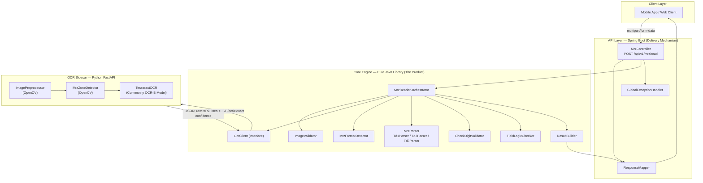
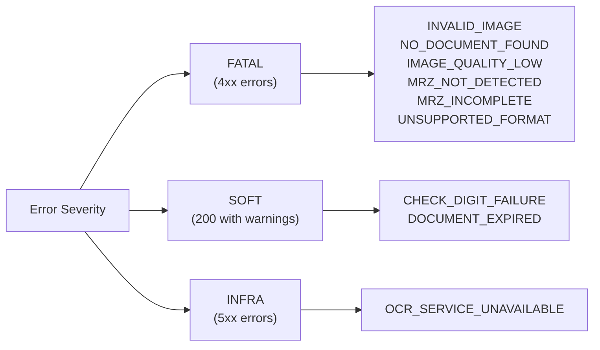
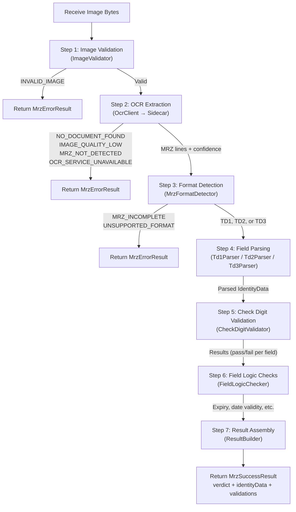
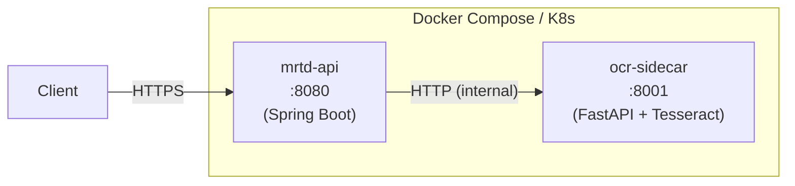

# MRZ Reader — Architecture & Implementation Plan

## 1. Product Overview

The **MRZ Reader** is the foundational product in the MRTD verification platform. It accepts an image of a travel document, extracts the Machine Readable Zone (MRZ), parses it according to ICAO Doc 9303, validates all check digits and field logic, and returns a structured identity data payload with a verification verdict.

The MRZ Reader is composed of two sub-products:
1. **MRZ OCR Engine** — Image preprocessing, MRZ zone detection, and optical character recognition
2. **MRZ Validation & Data Structuring** — Format detection, ICAO-compliant field parsing, check digit validation, field logic checks, and structured response assembly

### 1.1 Delivery Strategy
- **API First** — A REST API (Spring Boot) for banks, fintechs, hotels, airports
- **Then SDK** — A pure Java library (the core engine) embeddable in Android apps, server-side JVM applications, or any Java runtime
- **Shared Core** — Both API and SDK share the same core engine. Spring Boot is a delivery mechanism, not the product.

### 1.2 Success Criteria

| Metric | Target | Measurement |
|---|---|---|
| MRZ Read Accuracy | ≥ 95% | Character-level accuracy on a benchmark dataset of 500+ document images |
| Check Digit Validation Accuracy | ≥ 99%, zero false passes | Unit tests covering all ICAO check digit permutations, fuzz testing |
| API Response Time (p95) | ≤ 2 seconds | End-to-end from image upload to JSON response, measured under load |

---

## 2. System Architecture Overview



### 2.1 Key Architectural Decisions

| Decision | Rationale |
|---|---|
| **Core engine is a pure Java library with zero Spring dependencies** | Enables embedding in any JVM process. The core engine IS the product. Spring Boot is just one delivery mechanism. Android SDK packaging deferred to a later phase. |
| **Tesseract runs as a Python FastAPI sidecar, not via tess4j** | Avoids JNI/native library pain on different OS/architectures. Python has superior OpenCV and Tesseract bindings. Enables independent scaling and updates. Keeps the core engine pure Java. |
| **Community OCR-B model (`ocrb_int`)** | Start with the community `ocrb_int` traineddata for Tesseract. Lower effort to get started; upgrade to a custom fine-tuned model only if accuracy targets aren't met in Phase 6. |
| **Feature-based package organization** | Code is organized by business capability (image, ocr, parsing, checksum, etc.) not by technical layer (service, repository, controller). Each feature is a cohesive, self-contained unit. |
| **Interface-based OCR client in core engine** | The core engine defines an `OcrClient` interface. The default implementation is HTTP-based (calls the sidecar). Future SDK consumers can provide alternative OCR implementations. |
| **Pipeline orchestration pattern** | The `MrzReaderOrchestrator` chains all steps in a defined pipeline with fail-fast error handling at each stage. Each step produces a typed result or a terminal error. |
| **Built-in API key auth + rate limiting** | API key authentication and per-key rate limiting are built directly into the Spring Boot API layer, not deferred to an external gateway. |
| **Java 25 LTS + Spring Boot 3.x** | Latest LTS with modern language features (records, sealed interfaces, pattern matching). Spring Boot 3 for Jakarta EE namespace and native compilation readiness. |

---

## 3. Architectural Layers

The system is organized into **four distinct layers**, each with clear responsibilities and boundaries.

### Layer 1 — OCR Sidecar (Python FastAPI)

> **Responsibility:** Accept a document image, preprocess it, detect the MRZ zone, run OCR, and return raw MRZ text with confidence scores.

| Concern | Detail |
|---|---|
| **Runtime** | Python 3.12+, FastAPI, Uvicorn |
| **Image Preprocessing** | OpenCV — grayscale conversion, Gaussian blur, edge detection (Canny), deskew (Hough line transform), perspective correction (4-point warp), adaptive thresholding (Gaussian) |
| **MRZ Zone Detection** | OpenCV — morphological operations (blackhat kernel), contour detection, region filtering by aspect ratio and position (MRZ is always at the bottom of the document) |
| **OCR** | Tesseract 5.x with community `ocrb_int` traineddata, whitelisted charset `A-Z0-9<`, PSM 6 (uniform block of text) |
| **Output** | JSON: `{ "mrz_lines": [...], "confidence": 0.0-1.0, "zone_bbox": {...}, "preprocessing_applied": [...] }` |
| **Containerization** | Dockerfile with tesseract-ocr, opencv-python-headless, custom tessdata |

### Layer 2 — Core Engine (Pure Java Library)

> **Responsibility:** The product itself. Takes raw MRZ text (from any OCR source), detects format, parses fields per ICAO Doc 9303, validates check digits, runs field logic, and produces a structured result. Also handles image validation and OCR client orchestration.

| Concern | Detail |
|---|---|
| **Runtime** | Java 25 LTS, zero external framework dependencies |
| **Build** | Gradle module, produces a JAR artifact |
| **Key Constraint** | No Spring, no Jakarta EE, no servlet API. Pure JVM library. Android SDK packaging deferred to a later phase. |
| **Dependencies** | Minimal: SLF4J (logging facade), Jackson (JSON serialization for OCR client), and nothing else. |
| **Testing** | JUnit 5, Mockito, AssertJ |

### Layer 3 — API Layer (Spring Boot)

> **Responsibility:** A thin REST delivery wrapper around the core engine. Handles HTTP concerns: multipart file upload, content negotiation, error serialization, rate limiting, observability.

| Concern | Detail |
|---|---|
| **Runtime** | Spring Boot 3.x on Java 25 |
| **Endpoints** | `POST /api/v1/mrz/read` (multipart image upload) |
| **Cross-cutting** | Global exception handling, request validation, OpenAPI/Swagger docs, structured logging, metrics (Micrometer) |
| **Cross-cutting** | API key authentication, per-key rate limiting (Bucket4j or Resilience4j), global exception handling, request validation, OpenAPI/Swagger docs, structured logging, metrics (Micrometer) |
| **Configuration** | OCR sidecar URL, max file size, timeouts, rate limit tiers |

### Layer 4 — Orchestration (Inside Core Engine)

> **Responsibility:** Coordinates the end-to-end MRZ reading pipeline. Implements the step-by-step workflow with fail-fast error handling. This is the single entry point for consuming the core engine.

| Concern | Detail |
|---|---|
| **Pattern** | Pipeline / Chain of Responsibility |
| **Steps** | ImageValidation → OCR → FormatDetection → Parsing → CheckDigitValidation → FieldLogicCheck → ResultAssembly |
| **Error Handling** | Each step can produce a terminal error that short-circuits the pipeline and returns an error result (not an exception). Errors are domain values, not exceptions. |

---

## 4. ICAO Doc 9303 — MRZ Specifications

### 4.1 TD3 — Machine Readable Passport (2 lines × 44 characters)

#### Line 1 (44 characters) — Identity Line
```
Position  Length  Field
───────────────────────────────────────────────
1         1       Document code primary (P)
2         1       Document code secondary (< or letter)
3–5       3       Issuing state or organization (ISO 3166-1 alpha-3)
6–44      39      Name (PRIMARY<<GIVEN<NAMES, padded with <)
```

#### Line 2 (44 characters) — Data Line
```
Position  Length  Field                            Check Digit?
──────────────────────────────────────────────────────────────
1–9       9       Document number                  Yes → pos 10
10        1       Check digit (document number)
11–13     3       Nationality (ISO 3166-1 alpha-3)
14–19     6       Date of birth (YYMMDD)           Yes → pos 20
20        1       Check digit (date of birth)
21        1       Sex (M / F / <)
22–27     6       Date of expiry (YYMMDD)          Yes → pos 28
28        1       Check digit (date of expiry)
29–42     14      Optional data (personal number)  Yes → pos 43
43        1       Check digit (optional data)
44        1       COMPOSITE check digit            Computed over:
                                                   pos 1–10, 14–20, 22–43
                                                   (of line 2)
```

### 4.2 TD1 — Machine Readable ID Card (3 lines × 30 characters)

#### Line 1 (30 characters)
```
Position  Length  Field                            Check Digit?
──────────────────────────────────────────────────────────────
1–2       2       Document code (I< or ID, etc.)
3–5       3       Issuing state (ISO 3166-1 alpha-3)
6–14      9       Document number                  Yes → pos 15
15        1       Check digit (document number)
16–30     15      Optional data I
```

#### Line 2 (30 characters)
```
Position  Length  Field                            Check Digit?
──────────────────────────────────────────────────────────────
1–6       6       Date of birth (YYMMDD)           Yes → pos 7
7         1       Check digit (date of birth)
8         1       Sex (M / F / <)
9–14      6       Date of expiry (YYMMDD)          Yes → pos 15
15        1       Check digit (date of expiry)
16–18     3       Nationality (ISO 3166-1 alpha-3)
19–29     11      Optional data II
30        1       COMPOSITE check digit            Computed over:
                                                   Line 1 pos 6–30 +
                                                   Line 2 pos 1–7 +
                                                   Line 2 pos 9–15 +
                                                   Line 2 pos 19–29
```

#### Line 3 (30 characters)
```
Position  Length  Field
───────────────────────────────────────────────
1–30      30      Name (PRIMARY<<GIVEN<NAMES, padded with <)
```

### 4.3 TD2 — Machine Readable Official Travel Document (2 lines × 36 characters)

> ICAO Doc 9303 Part 6. Used by some countries for ID cards and travel documents.

#### Line 1 (36 characters) — Identity Line
```
Position  Length  Field
───────────────────────────────────────────────
1–2       2       Document code (I<, ID, AC, etc.)
3–5       3       Issuing state or organization (ISO 3166-1 alpha-3)
6–36      31      Name (PRIMARY<<GIVEN<NAMES, padded with <)
```

#### Line 2 (36 characters) — Data Line
```
Position  Length  Field                            Check Digit?
──────────────────────────────────────────────────────────────
1–9       9       Document number                  Yes → pos 10
10        1       Check digit (document number)
11–13     3       Nationality (ISO 3166-1 alpha-3)
14–19     6       Date of birth (YYMMDD)           Yes → pos 20
20        1       Check digit (date of birth)
21        1       Sex (M / F / <)
22–27     6       Date of expiry (YYMMDD)          Yes → pos 28
28        1       Check digit (date of expiry)
29–35     7       Optional data
36        1       COMPOSITE check digit            Computed over:
                                                   pos 1–10, 14–20, 22–35
                                                   (of line 2)
```

> [!NOTE]
> TD2 Line 2 has the same field layout as TD3 Line 2, but is 36 characters instead of 44. The optional data field is shorter (7 chars vs 14), and there is no separate check digit for optional data — it is included in the composite.

### 4.4 MRV — Machine Readable Visa (Detect & Reject)

| Format | Lines | Chars/Line | Document Code | Action |
|---|---|---|---|---|
| MRV-A | 2 | 44 | V | Reject: `UNSUPPORTED_FORMAT` |
| MRV-B | 2 | 36 | V | Reject: `UNSUPPORTED_FORMAT` |

**Detection heuristic:** If document code starts with `V`, it is a visa format → return `UNSUPPORTED_FORMAT`.

### 4.5 Check Digit Algorithm (ICAO Weighting Scheme)

```
Weights (repeating cycle):  7, 3, 1, 7, 3, 1, ...

Character values:
  0-9  →  0–9
  A-Z  →  10–35
  <    →  0

Algorithm:
  1. For each character in the field, multiply its value by the corresponding weight
  2. Sum all products
  3. Result = sum mod 10
  4. The result must equal the check digit character (as an integer)
```

**Example:** Document number `L898902C3`, expected check digit `6`
```
L(21)×7 + 8×3 + 9×1 + 8×7 + 9×3 + 0×1 + 2×7 + C(12)×3 + 3×1
= 147 + 24 + 9 + 56 + 27 + 0 + 14 + 36 + 3 = 316
316 mod 10 = 6  ✓
```

---

## 5. Module & Package Structure

```
d:\projects\MRTD\
├── settings.gradle
├── build.gradle                          # Root build: dependency management
│
├── mrtd-core/                            # MODULE: Core Engine (The Product)
│   ├── build.gradle
│   └── src/
│       ├── main/java/com/certipass/mrtd/core/
│       │   ├── image/                    # FEATURE: Image Validation
│       │   │   ├── ImageValidator.java           # Validates format, size, corruption
│       │   │   ├── ImageMetadata.java             # Record: width, height, format, sizeBytes
│       │   │   └── ImageValidationResult.java     # Valid or error with reason
│       │   │
│       │   ├── ocr/                      # FEATURE: OCR Integration
│       │   │   ├── OcrClient.java                 # Interface: extractMrz(byte[] image) → OcrResult
│       │   │   ├── OcrResult.java                 # Record: mrzLines, confidence, bbox
│       │   │   └── http/
│       │   │       └── HttpOcrClient.java         # Default impl: calls FastAPI sidecar via HTTP
│       │   │
│       │   ├── detection/                # FEATURE: MRZ Format Detection
│       │   │   ├── MrzFormatDetector.java          # Detects TD1, TD2, TD3, or unsupported
│       │   │   └── MrzFormat.java                  # Enum: TD1, TD2, TD3
│       │   │
│       │   ├── parsing/                  # FEATURE: ICAO Field Parsing
│       │   │   ├── MrzParser.java                  # Interface
│       │   │   ├── MrzParserFactory.java           # Returns correct parser for format
│       │   │   ├── Td1MrzParser.java               # Parses TD1 (3 lines × 30 chars)
│       │   │   ├── Td2MrzParser.java               # Parses TD2 (2 lines × 36 chars)
│       │   │   ├── Td3MrzParser.java               # Parses TD3 (2 lines × 44 chars)
│       │   │   └── NameParser.java                 # Shared: splits PRIMARY<<GIVEN<NAMES
│       │   │
│       │   ├── checksum/                 # FEATURE: Check Digit Validation
│       │   │   ├── CheckDigitValidator.java        # ICAO 7-3-1 weighting algorithm
│       │   │   ├── CheckDigitResult.java           # Per-field pass/fail + expected/actual
│       │   │   └── CompositeCheckDigit.java        # Composite check digit computation
│       │   │
│       │   ├── fieldlogic/               # FEATURE: Field Logic Checks
│       │   │   ├── FieldLogicChecker.java          # Orchestrates all logic checks
│       │   │   ├── ExpiryCheck.java                # Is the document expired?
│       │   │   ├── DateValidityCheck.java          # Are dates valid calendar dates?
│       │   │   ├── StateCodeCheck.java             # Is issuing state a valid ISO 3166-1 code?
│       │   │   ├── SexFieldCheck.java              # Is sex M, F, or < ?
│       │   │   └── FieldLogicResult.java           # Aggregated logic check results
│       │   │
│       │   ├── orchestration/            # FEATURE: Pipeline Orchestration
│       │   │   ├── MrzReaderOrchestrator.java      # THE entry point: readMrz(byte[] image) → MrzReadResult
│       │   │   ├── PipelineStep.java               # Interface: execute(PipelineContext) → StepResult
│       │   │   ├── PipelineContext.java             # Mutable context passed through pipeline
│       │   │   └── PipelineExecutor.java            # Executes steps sequentially, handles fail-fast
│       │   │
│       │   └── model/                    # SHARED: Domain Models
│       │       ├── MrzReadResult.java               # Top-level result (sealed interface)
│       │       ├── MrzSuccessResult.java            # Success: verdict, identity, validations
│       │       ├── MrzErrorResult.java              # Error: error code, message
│       │       ├── IdentityData.java                # Parsed identity fields
│       │       ├── Verdict.java                     # Enum: VALID, VALID_WITH_WARNINGS, INVALID
│       │       ├── ConfidenceScore.java             # Value object: 0.0 – 1.0
│       │       ├── ValidationDetail.java            # Per-check result (field, pass/fail, message)
│       │       ├── ErrorCode.java                   # Enum: all error states
│       │       └── MrzRawData.java                  # Raw MRZ strings + format
│       │
│       └── test/java/com/certipass/mrtd/core/  # Mirror structure for tests
│           ├── checksum/
│           │   └── CheckDigitValidatorTest.java
│           ├── parsing/
│           │   ├── Td1MrzParserTest.java
│           │   ├── Td2MrzParserTest.java
│           │   └── Td3MrzParserTest.java
│           ├── detection/
│           │   └── MrzFormatDetectorTest.java
│           ├── fieldlogic/
│           │   └── FieldLogicCheckerTest.java
│           └── orchestration/
│               └── MrzReaderOrchestratorTest.java
│
├── mrtd-api/                             # MODULE: Spring Boot API (Delivery Mechanism)
│   ├── build.gradle
│   └── src/
│       ├── main/java/com/certipass/mrtd/api/
│       │   ├── MrtdApiApplication.java              # Spring Boot entry point
│       │   ├── mrz/                      # FEATURE: MRZ Reading Endpoint
│       │   │   ├── MrzController.java               # POST /api/v1/mrz/read
│       │   │   ├── MrzReadRequestDto.java           # Multipart file + options
│       │   │   ├── MrzReadResponseDto.java          # JSON response DTO
│       │   │   └── MrzResponseMapper.java           # Core model → API DTO mapping
│       │   │
│       │   ├── auth/                     # FEATURE: API Key Authentication
│       │   │   ├── ApiKeyAuthFilter.java            # Servlet filter: validates X-API-Key header
│       │   │   ├── ApiKeyProperties.java            # Externalized API key config
│       │   │   └── ApiKeyRepository.java            # In-memory or DB-backed key store
│       │   │
│       │   ├── ratelimit/                # FEATURE: Rate Limiting
│       │   │   ├── RateLimitFilter.java             # Per-API-key rate limiting filter
│       │   │   ├── RateLimitProperties.java         # Configurable limits per tier
│       │   │   └── RateLimitExceededResponse.java   # 429 Too Many Requests response
│       │   │
│       │   ├── config/                   # CROSS-CUTTING: Configuration
│       │   │   ├── CoreEngineConfig.java            # Wires core engine beans
│       │   │   ├── OcrSidecarProperties.java        # OCR sidecar URL, timeouts
│       │   │   ├── SecurityConfig.java              # Filter chain registration
│       │   │   └── WebConfig.java                   # CORS, multipart config
│       │   │
│       │   └── error/                    # CROSS-CUTTING: Error Handling
│       │       ├── GlobalExceptionHandler.java      # @ControllerAdvice
│       │       └── ApiErrorResponse.java            # Standardized error envelope
│       │
│       └── main/resources/
│           ├── application.yml                      # Spring config
│           └── application-dev.yml                  # Dev profile
│
└── ocr-sidecar/                          # MODULE: Python FastAPI OCR Service
    ├── Dockerfile
    ├── requirements.txt
    ├── pyproject.toml
    └── app/
        ├── main.py                                  # FastAPI app + /ocr/extract endpoint
        ├── preprocessing/                # FEATURE: Image Preprocessing
        │   ├── __init__.py
        │   ├── pipeline.py                          # Orchestrates preprocessing steps
        │   ├── grayscale.py                         # Grayscale conversion
        │   ├── denoise.py                           # Gaussian blur / bilateral filter
        │   ├── deskew.py                            # Hough line transform + rotation
        │   ├── perspective.py                       # 4-point perspective correction
        │   └── threshold.py                         # Adaptive Gaussian thresholding
        │
        ├── detection/                    # FEATURE: MRZ Zone Detection
        │   ├── __init__.py
        │   └── zone_detector.py                     # Morphological ops + contour filtering
        │
        ├── ocr/                          # FEATURE: Tesseract OCR
        │   ├── __init__.py
        │   └── engine.py                            # Tesseract with OCR-B model, charset whitelist
        │
        ├── models/                       # Pydantic Models
        │   ├── __init__.py
        │   ├── request.py
        │   └── response.py
        │
        └── tessdata/                     # Community Trained Model
            └── ocrb_int.traineddata                 # Community OCR-B traineddata (ocrb_int)
```

---

## 6. Error Handling Strategy

### 6.1 Error Codes (Defined in Core Engine)

| Error Code | HTTP Status | Pipeline Stage | Behavior |
|---|---|---|---|
| `INVALID_IMAGE` | 400 | **Image Validation** (fail fast) | File is corrupt, exceeds size limit (e.g., >10MB), or unsupported format (not JPEG/PNG). No processing occurs. |
| `NO_DOCUMENT_FOUND` | 422 | **OCR Sidecar** | Image processed but no document detected in the frame. |
| `IMAGE_QUALITY_LOW` | 422 | **OCR Sidecar** | Image too blurry, dark, or low resolution for reliable OCR. Sidecar returns quality score < threshold. |
| `MRZ_NOT_DETECTED` | 422 | **MRZ Zone Detection** | Document found but no MRZ zone could be isolated. |
| `MRZ_INCOMPLETE` | 422 | **Format Detection** | MRZ detected but lines are truncated or character count doesn't match TD1/TD2/TD3. |
| `UNSUPPORTED_FORMAT` | 422 | **Format Detection** | MRZ detected but it's an MRV-A or MRV-B (visa) format. Document code starts with `V`. |
| `RATE_LIMIT_EXCEEDED` | 429 | **API Layer** (pre-pipeline) | Client has exceeded their rate limit. Includes `Retry-After` header. |
| `UNAUTHORIZED` | 401 | **API Layer** (pre-pipeline) | Missing or invalid API key in `X-API-Key` header. |
| `CHECK_DIGIT_FAILURE` | 200 | **Check Digit Validation** | One or more check digits failed. Returns full data with per-field failure details. Verdict: `INVALID`. |

| `DOCUMENT_EXPIRED` | 200 | **Field Logic** | MRZ is valid but expiry date is in the past. **Not a hard failure.** Returns data with `is_expired: true`. Verdict: `VALID_WITH_WARNINGS`. |
| `OCR_SERVICE_UNAVAILABLE` | 503 | **OCR Client** | The OCR sidecar is unreachable. Circuit breaker / retry with backoff. |

### 6.2 Error Handling Philosophy



- **FATAL errors** → Pipeline short-circuits. No partial data returned. Client must fix input.
- **SOFT errors** → Pipeline completes. Full data returned with warnings and appropriate verdict. The caller decides how to handle.
- **INFRA errors** → Transient infrastructure failure. Retry-safe. Circuit breaker pattern.

### 6.3 Error Modeling in Core Engine (No Exceptions for Business Errors)

Domain errors are **values, not exceptions**. The `MrzReadResult` is a sealed interface:

```
MrzReadResult (sealed interface)
├── MrzSuccessResult   → verdict, identityData, validations, confidence, rawMrz, metadata
└── MrzErrorResult     → errorCode, message, timestamp
```

This forces callers to handle both success and error cases explicitly (pattern matching in Java 25). Exceptions are reserved for truly exceptional conditions (OOM, I/O failures, programming bugs).

---

## 7. Pipeline Orchestration Flow



### 7.1 Pipeline Context

The `PipelineContext` is a mutable object that flows through all steps, accumulating data:

```
PipelineContext:
  - inputImage: byte[]
  - imageMetadata: ImageMetadata          (set by Step 1)
  - ocrResult: OcrResult                  (set by Step 2)
  - mrzFormat: MrzFormat                  (set by Step 3)
  - identityData: IdentityData            (set by Step 4)
  - checkDigitResults: List<CheckDigitResult>  (set by Step 5)
  - fieldLogicResults: List<FieldLogicResult>  (set by Step 6)
  - warnings: List<String>                (accumulated)
  - processingTimeMs: long                (accumulated)
```

---

## 8. API Contract

### 8.1 Request

```
POST /api/v1/mrz/read
Content-Type: multipart/form-data
X-API-Key: your-api-key-here

Parameters:
  - file: (required) JPEG or PNG image, max 10MB
```

### 8.2 Success Response (200 OK)

```json
{
  "verdict": "VALID",
  "confidence_score": 0.97,
  "identity_data": {
    "document_type": "PASSPORT",
    "document_code": "P",
    "issuing_state": "NGA",
    "surname": "OKONKWO",
    "given_names": "CHUKWUEMEKA JOHN",
    "document_number": "A12345678",
    "nationality": "NGA",
    "date_of_birth": "1990-08-15",
    "sex": "M",
    "date_of_expiry": "2030-08-14",
    "optional_data": "",
    "is_expired": false
  },
  "validation_results": {
    "check_digits": {
      "overall_pass": true,
      "details": [
        { "field": "document_number", "expected": 3, "actual": 3, "pass": true },
        { "field": "date_of_birth", "expected": 2, "actual": 2, "pass": true },
        { "field": "date_of_expiry", "expected": 8, "actual": 8, "pass": true },
        { "field": "optional_data", "expected": 0, "actual": 0, "pass": true },
        { "field": "composite", "expected": 6, "actual": 6, "pass": true }
      ]
    },
    "field_logic": {
      "overall_pass": true,
      "details": [
        { "check": "date_of_birth_valid", "pass": true, "message": "Valid calendar date" },
        { "check": "date_of_expiry_valid", "pass": true, "message": "Valid calendar date" },
        { "check": "document_not_expired", "pass": true, "message": "Expires 2030-08-14" },
        { "check": "issuing_state_valid", "pass": true, "message": "NGA is a valid ISO 3166-1 alpha-3 code" },
        { "check": "sex_field_valid", "pass": true, "message": "Valid value: M" }
      ]
    }
  },
  "raw_mrz": {
    "format": "TD3",
    "lines": [
      "P<NGAOKONKWO<<CHUKWUEMEKA<JOHN<<<<<<<<<<<<<<<",
      "A123456783NGA9008152M3008148<<<<<<<<<<<<<<06"
    ]
  },
  "metadata": {
    "processing_time_ms": 1243,
    "ocr_confidence": 0.97,
    "mrz_format": "TD3",
    "api_version": "1.0.0",
    "timestamp": "2026-05-21T14:30:00Z"
  }
}
```

### 8.3 Error Response (4xx / 5xx)

```json
{
  "error": {
    "code": "MRZ_NOT_DETECTED",
    "message": "A document was found in the image but no Machine Readable Zone could be detected. Ensure the full MRZ area is visible and well-lit.",
    "timestamp": "2026-05-21T14:30:00Z",
    "request_id": "req_abc123"
  }
}
```

### 8.4 Auth / Rate Limit Error Responses

```json
// 401 Unauthorized
{
  "error": {
    "code": "UNAUTHORIZED",
    "message": "Missing or invalid API key. Provide a valid key in the X-API-Key header.",
    "timestamp": "2026-05-21T14:30:00Z"
  }
}
```

```json
// 429 Too Many Requests (includes Retry-After header)
{
  "error": {
    "code": "RATE_LIMIT_EXCEEDED",
    "message": "Rate limit exceeded. You are allowed 100 requests per minute.",
    "timestamp": "2026-05-21T14:30:00Z",
    "retry_after_seconds": 12
  }
}
```

---

## 9. OCR Sidecar — Internal API Contract

### 9.1 Request

```
POST /ocr/extract
Content-Type: multipart/form-data

Parameters:
  - image: (required) JPEG or PNG image bytes
```

### 9.2 Response (200 OK)

```json
{
  "status": "SUCCESS",
  "mrz_lines": [
    "P<NGAOKONKWO<<CHUKWUEMEKA<JOHN<<<<<<<<<<<<<<<",
    "A123456783NGA9008152M3008148<<<<<<<<<<<<<<06"
  ],
  "confidence": 0.97,
  "zone_bbox": {
    "x": 50,
    "y": 420,
    "width": 600,
    "height": 80
  },
  "image_quality_score": 0.85,
  "preprocessing_applied": [
    "grayscale",
    "deskew_2.3_degrees",
    "adaptive_threshold"
  ]
}
```

### 9.3 Error Responses

```json
{
  "status": "NO_DOCUMENT_FOUND",
  "message": "No document detected in the image frame"
}
```

```json
{
  "status": "IMAGE_QUALITY_LOW",
  "message": "Image quality score 0.23 is below threshold 0.40",
  "image_quality_score": 0.23
}
```

```json
{
  "status": "MRZ_NOT_DETECTED",
  "message": "Document found but MRZ zone could not be isolated"
}
```

---

## 10. Tech Stack Summary

| Component | Technology | Version |
|---|---|---|
| **Core Engine** | Java (pure library) | 25 LTS |
| **API** | Spring Boot | 3.x (latest) |
| **OCR Sidecar** | Python + FastAPI + Uvicorn | 3.12+ / 0.115+ |
| **Image Processing** | OpenCV (Python) | 4.x |
| **OCR Engine** | Tesseract | 5.x |
| **MRZ Font Model** | Community `ocrb_int` traineddata | Community |
| **Build System** | Gradle (multi-module) | 8.x |
| **JSON** | Jackson (core engine), Pydantic (sidecar) | Latest |
| **Logging** | SLF4J (core), Logback (API) | Latest |
| **Testing** | JUnit 5, Mockito, AssertJ, pytest | Latest |
| **Containerization** | Docker, Docker Compose | Latest |
| **API Docs** | SpringDoc OpenAPI (Swagger UI) | Latest |
| **Rate Limiting** | Bucket4j (token bucket) | Latest |
| **Metrics** | Micrometer + Prometheus (API only) | Latest |

---

## 11. Phased Implementation Plan

---

### Phase 1 — Foundation & Domain Models

> **Goal:** Establish the multi-module project structure, define all domain models, error codes, interfaces, and build configuration. After this phase, the entire type system is in place and engineers can work on features in parallel.

#### Engineer Tasks

| # | Task | Module | Details |
|---|---|---|---|
| 1.1 | **Initialize Gradle multi-module project** | Root | Create `settings.gradle` with three modules: `mrtd-core`, `mrtd-api`, (OCR sidecar is not Gradle-managed). Configure Java 25 toolchain, dependency management (BOM), code formatting (Spotless). |
| 1.2 | **Define core domain models** | `mrtd-core` | Create all records/classes in `model/` package: `MrzReadResult` (sealed interface), `MrzSuccessResult`, `MrzErrorResult`, `IdentityData`, `Verdict` (enum), `ConfidenceScore` (value object), `ValidationDetail`, `MrzRawData`, `ErrorCode` (enum with all error states). |
| 1.3 | **Define image validation models** | `mrtd-core` | `ImageMetadata` (record: width, height, format, sizeBytes), `ImageValidationResult` (sealed: Valid / Invalid with ErrorCode). |
| 1.4 | **Define OCR models & interface** | `mrtd-core` | `OcrClient` (interface with `extractMrz(byte[] imageData): OcrResult`), `OcrResult` (record: mrzLines, confidence, qualityScore, bbox, preprocessingApplied), `OcrErrorResult`. |
| 1.5 | **Define MRZ format enum** | `mrtd-core` | `MrzFormat` enum: `TD1(3, 30)`, `TD2(2, 36)`, `TD3(2, 44)` with line count and chars-per-line. |
| 1.6 | **Define parser interface** | `mrtd-core` | `MrzParser` interface: `parse(List<String> mrzLines): IdentityData`. `MrzParserFactory`: returns correct parser for `MrzFormat`. |
| 1.7 | **Define checksum models** | `mrtd-core` | `CheckDigitResult` (record: fieldName, expectedDigit, actualDigit, pass). `CompositeCheckDigitSpec` for TD1/TD2/TD3. |
| 1.8 | **Define field logic models** | `mrtd-core` | `FieldLogicResult` (record: checkName, pass, message). |
| 1.9 | **Define orchestration interfaces** | `mrtd-core` | `PipelineStep<T>` interface, `PipelineContext` class, `PipelineExecutor`. |
| 1.10 | **Set up test infrastructure** | `mrtd-core` | JUnit 5 + Mockito + AssertJ dependencies. Create test fixture data: valid TD1 MRZ strings, valid TD2 MRZ strings, valid TD3 MRZ strings, known-bad MRZ strings. |

#### Exit Criteria
- [ ] `./gradlew build` compiles with zero errors
- [ ] All domain model classes are defined with Javadoc
- [ ] Test fixtures contain at least 5 valid TD3 MRZs, 5 valid TD2 MRZs, and 5 valid TD1 MRZs from ICAO Doc 9303 examples

---

### Phase 2 — OCR Sidecar Service

> **Goal:** Build the Python FastAPI service that accepts a document image, preprocesses it, detects the MRZ zone, runs Tesseract OCR, and returns raw MRZ text with confidence scores. This runs independently as a containerized microservice.

#### Engineer Tasks

| # | Task | Details |
|---|---|---|
| 2.1 | **Initialize Python project** | Create `ocr-sidecar/` with `pyproject.toml`, `requirements.txt` (fastapi, uvicorn, opencv-python-headless, pytesseract, pillow, numpy, python-multipart). |
| 2.2 | **Implement image preprocessing pipeline** | `preprocessing/pipeline.py`: Orchestrate steps in order: (1) Decode image bytes → numpy array, (2) Convert to grayscale, (3) Apply Gaussian blur (5×5 kernel), (4) Detect skew angle via Hough line transform → rotate to deskew, (5) Apply perspective correction if quadrilateral detected, (6) Apply adaptive Gaussian thresholding (blockSize=11, C=2). Each step logs what it did. Track which steps were applied. |
| 2.3 | **Implement MRZ zone detection** | `detection/zone_detector.py`: (1) Apply blackhat morphological operation (rectangular kernel 13×5) to highlight dark text on light background, (2) Compute Sobel gradient (x-direction) + threshold, (3) Apply closing operation (rectangular kernel 21×7) to merge characters into MRZ band, (4) Find contours, filter by: aspect ratio > 5:1, area > threshold, positioned in bottom 40% of image, (5) Return bounding box of MRZ zone. If no qualifying contour found → return `MRZ_NOT_DETECTED`. |
| 2.4 | **Implement image quality scoring** | Compute Laplacian variance of the MRZ zone crop as a blur metric. Score 0.0–1.0. If below configurable threshold (default 0.40) → return `IMAGE_QUALITY_LOW`. |
| 2.5 | **Implement Tesseract OCR integration** | `ocr/engine.py`: (1) Configure Tesseract with custom OCR-B traineddata path, (2) Set `--psm 6` (single uniform block of text), (3) Set `-c tessedit_char_whitelist=ABCDEFGHIJKLMNOPQRSTUVWXYZ0123456789<`, (4) Run on MRZ zone crop, (5) Post-process: strip whitespace, normalize line breaks, validate line count and character count per line, (6) Compute per-character confidence from Tesseract's word-level confidence. |
| 2.6 | **Build FastAPI endpoint** | `main.py`: `POST /ocr/extract` accepting multipart image. Chain: preprocess → detect zone → quality check → OCR → return response. Health endpoint: `GET /health`. |
| 2.7 | **Create Dockerfile** | Base image: `python:3.12-slim`. Install `tesseract-ocr`, `libgl1-mesa-glx`, `libglib2.0-0`. Copy custom traineddata to `/usr/share/tesseract-ocr/5/tessdata/`. Expose port 8001. |
| 2.8 | **Obtain community OCR-B model** | Download the `ocrb_int` traineddata from the Tesseract community (tessdata_best or tessdata_fast repositories). Place in `ocr-sidecar/app/tessdata/`. Validate accuracy against known MRZ strings. If accuracy is below 90% on test images, document findings and flag for potential custom fine-tuning in Phase 6. |
| 2.9 | **Write tests** | Pytest tests for each preprocessing step (with sample images), zone detection (with annotated test images), OCR accuracy (against known MRZ strings). |

#### Exit Criteria
- [ ] `POST /ocr/extract` with a clear passport photo returns correct MRZ lines
- [ ] Docker container builds and runs with `docker compose up`
- [ ] ≥ 90% character accuracy on 20 test images (baseline; will improve in Phase 6)

---

### Phase 3 — Core Engine: MRZ Parsing & Validation

> **Goal:** Implement the pure Java core engine logic: MRZ format detection, ICAO-compliant field parsing for TD1, TD2, and TD3, check digit validation, and field logic checks. This is the heart of the product.

#### Engineer Tasks

| # | Task | Details |
|---|---|---|
| 3.1 | **Implement MrzFormatDetector** | Input: `List<String>` MRZ lines. Logic: (1) If 2 lines × 44 chars and line 1 starts with `P` → TD3. (2) If 2 lines × 44 chars and line 1 starts with `V` → `UNSUPPORTED_FORMAT` (MRV-A). (3) If 2 lines × 36 chars and line 1 starts with `V` → `UNSUPPORTED_FORMAT` (MRV-B). (4) If 2 lines × 36 chars and line 1 does NOT start with `V` → TD2. (5) If 3 lines × 30 chars and line 1 starts with `I` or `A` or `C` → TD1. (6) Otherwise → `MRZ_INCOMPLETE`. Write exhaustive unit tests. |
| 3.2 | **Implement Td3MrzParser** | Parse fixed positions per ICAO Doc 9303 Part 4 (see Section 4.1 of this document). Extract: documentCode, issuingState, name (via NameParser), documentNumber, nationality, dateOfBirth, sex, dateOfExpiry, optionalData. Convert fillers (`<`) to spaces/empty strings. Format dates as ISO 8601. Write tests against ICAO example MRZs. |
| 3.3 | **Implement Td2MrzParser** | Parse fixed positions per ICAO Doc 9303 Part 6 (see Section 4.3 of this document). Similar to TD3 but 2 lines × 36 chars. Line 1 has name in positions 6–36 (31 chars). Line 2 layout matches TD3 Line 2 but shorter optional data (7 chars, positions 29–35) with no separate optional data check digit. Composite check digit at position 36 covers positions 1–10, 14–20, 22–35. Write tests against ICAO example MRZs. |
| 3.4 | **Implement Td1MrzParser** | Parse fixed positions per ICAO Doc 9303 Part 5 (see Section 4.2 of this document). Handle 3-line format. Extract all fields. Note: TD1 name is on line 3 (different from TD3/TD2). Write tests against ICAO example MRZs. |
| 3.5 | **Implement NameParser** | Shared utility: splits `PRIMARY<<GIVEN<NAMES` into `{ surname: "PRIMARY", givenNames: "GIVEN NAMES" }`. Handles edge cases: multiple given names separated by `<`, trailing fillers, names with only surname (no `<<` separator). |
| 3.6 | **Implement CheckDigitValidator** | Implement the ICAO 7-3-1 weighting algorithm (see Section 4.5). Methods: (1) `computeCheckDigit(String field): int` — computes check digit for a field. (2) `validateCheckDigit(String field, int expectedDigit): CheckDigitResult` — validates one check digit. (3) `validateAllCheckDigits(MrzFormat, List<String> mrzLines): List<CheckDigitResult>` — validates all check digits for the format (including composite). **Zero tolerance for false passes.** Write exhaustive tests with ICAO examples plus edge cases (all-filler fields, numeric-only fields). |
| 3.7 | **Implement composite check digit for TD3** | Composite covers Line 2 positions 1–10, 14–20, 22–43. Concatenate these substrings, compute check digit, compare with Line 2 position 44. |
| 3.8 | **Implement composite check digit for TD2** | Composite covers Line 2 positions 1–10, 14–20, 22–35. Concatenate these substrings, compute check digit, compare with Line 2 position 36. Note: no separate optional data check digit in TD2. |
| 3.9 | **Implement composite check digit for TD1** | Composite covers Line 1 positions 6–30 + Line 2 positions 1–7 + Line 2 positions 9–15 + Line 2 positions 19–29. Concatenate, compute, compare with Line 2 position 30. |
| 3.10 | **Implement FieldLogicChecker** | Checks: (1) **ExpiryCheck** — parse expiry date, compare with current date. If expired: set `is_expired: true`, add warning, don't fail. (2) **DateValidityCheck** — are DOB and expiry valid calendar dates? Handle YYMMDD → century inference (00–29 = 2000s, 30–99 = 1900s per ICAO convention). (3) **StateCodeCheck** — is issuing state in ISO 3166-1 alpha-3 list? Use a static lookup set (no external dependency). (4) **SexFieldCheck** — is sex field M, F, or `<`? |
| 3.11 | **Build ISO 3166-1 alpha-3 lookup** | Create a static set of all valid ISO 3166-1 alpha-3 country codes plus ICAO-specific codes (UTO for test, UNO, UNA, etc., D<< for Germany, GBR variants). Store as an enum or static Set<String>. |
| 3.12 | **Write comprehensive test suite** | (1) Test each parser (TD1, TD2, TD3) with ≥ 10 known MRZ strings (from ICAO examples and real-world patterns). (2) Test check digit validator with all ICAO example check digits. (3) Test edge cases: all-filler optional data, truncated names, expired documents, future DOB, invalid state codes. |

#### Exit Criteria
- [ ] 100% check digit validation accuracy on all test cases (zero false passes)
- [ ] All three parsers (TD1, TD2, TD3) correctly extract all fields from ICAO example MRZs
- [ ] `./gradlew :mrtd-core:test` passes with ≥ 95% line coverage on parsing/checksum/fieldlogic packages

---

### Phase 4 — Core Engine: Orchestration & OCR Client

> **Goal:** Wire everything together. Implement the HTTP OCR client, the pipeline orchestrator, and the result builder. After this phase, the core engine is fully functional end-to-end.

#### Engineer Tasks

| # | Task | Details |
|---|---|---|
| 4.1 | **Implement ImageValidator** | Validate: (1) Byte array is not null/empty. (2) File size ≤ 10MB (configurable). (3) Magic bytes check — starts with JPEG (`FF D8 FF`) or PNG (`89 50 4E 47`) header. (4) Basic image decode to extract width/height (use `javax.imageio.ImageIO` — available in standard JDK and Android). If any check fails → return `INVALID_IMAGE`. |
| 4.2 | **Implement HttpOcrClient** | Default implementation of `OcrClient` interface. Uses `java.net.http.HttpClient` (no external HTTP library). (1) Build multipart/form-data request with image bytes. (2) POST to sidecar URL (configurable). (3) Parse JSON response with Jackson. (4) Map sidecar error statuses to core `ErrorCode`. (5) Implement timeout (configurable, default 5s). (6) Handle connection failures → `OCR_SERVICE_UNAVAILABLE`. |
| 4.3 | **Implement PipelineStep interface** | `PipelineStep<T>`: `StepResult<T> execute(PipelineContext ctx)`. `StepResult<T>` is a sealed interface: `Success<T>(T value)` or `Failure(ErrorCode, String message)`. |
| 4.4 | **Implement concrete pipeline steps** | Create step implementations that wrap each feature: `ImageValidationStep`, `OcrExtractionStep`, `FormatDetectionStep`, `FieldParsingStep`, `CheckDigitValidationStep`, `FieldLogicCheckStep`, `ResultAssemblyStep`. Each step reads from and writes to `PipelineContext`. |
| 4.5 | **Implement PipelineExecutor** | Executes steps sequentially. On `Failure` → short-circuit and return `MrzErrorResult`. On `Success` → continue to next step. Track total processing time. |
| 4.6 | **Implement MrzReaderOrchestrator** | THE public API of the core engine. Single method: `MrzReadResult readMrz(byte[] imageData)`. Constructs the pipeline, creates context, executes, returns result. This is what the Spring controller and Android SDK call. Also supports an overload `MrzReadResult readMrz(byte[] imageData, OcrClient ocrClient)` for dependency injection of custom OCR implementations. |
| 4.7 | **Implement ResultBuilder** | Assembles `MrzSuccessResult` from `PipelineContext`. Logic: (1) Determine `Verdict`: if any check digit failed → `INVALID`. If expired → `VALID_WITH_WARNINGS`. Otherwise → `VALID`. (2) Compute `ConfidenceScore` from OCR confidence. (3) Build the full result with identity data, validations, raw MRZ, and metadata. |
| 4.8 | **Integration tests with mock OCR** | Create a `MockOcrClient` that returns pre-defined MRZ strings. Test the full pipeline end-to-end: image validation → mock OCR → parse → validate → result. Test all error paths. |

#### Exit Criteria
- [ ] Full pipeline executes end-to-end with `MockOcrClient`
- [ ] All error states are reachable and produce correct `MrzErrorResult`
- [ ] `MrzReaderOrchestrator.readMrz()` is the single entry point, no Spring dependencies
- [ ] `./gradlew :mrtd-core:test` — all tests pass

---

### Phase 5 — Spring Boot API Layer

> **Goal:** Wrap the core engine in a production-ready REST API with proper HTTP semantics, error handling, documentation, and observability.

#### Engineer Tasks

| # | Task | Details |
|---|---|---|
| 5.1 | **Initialize Spring Boot module** | `mrtd-api/build.gradle`: depend on `mrtd-core`, Spring Boot 3 starters (web, actuator, validation). Add Bucket4j for rate limiting. `MrtdApiApplication.java` with `@SpringBootApplication`. |
| 5.2 | **Configure core engine beans** | `CoreEngineConfig.java`: Wire `MrzReaderOrchestrator` as a Spring bean. Create `HttpOcrClient` bean with sidecar URL from `OcrSidecarProperties` (externalized config). |
| 5.3 | **Implement API key authentication** | `ApiKeyAuthFilter.java`: Servlet filter that extracts `X-API-Key` header, validates against `ApiKeyRepository` (initially backed by `application.yml` config, later DB). Returns 401 `UNAUTHORIZED` if missing or invalid. `SecurityConfig.java`: Register filter in the filter chain. Exempt `/actuator/health` and `/swagger-ui/**` from auth. |
| 5.4 | **Implement rate limiting** | `RateLimitFilter.java`: Per-API-key rate limiting using Bucket4j token bucket algorithm. `RateLimitProperties.java`: Configurable limits (e.g., `default: 100 req/min`, `premium: 1000 req/min`). Returns 429 `RATE_LIMIT_EXCEEDED` with `Retry-After` header when limit exceeded. Rate limit tiers mapped to API keys in config. |
| 5.5 | **Implement MrzController** | `POST /api/v1/mrz/read`: Accept `MultipartFile`, validate content type, extract bytes, call `orchestrator.readMrz(bytes)`, map result to DTO. Use `MrzResponseMapper` to convert core models → API DTOs. Return 200 for success (including soft errors), 400/422 for fatal errors. |
| 5.6 | **Define API DTOs** | `MrzReadResponseDto`: mirrors the success JSON contract (Section 8.2). Use Jackson annotations for snake_case JSON. `ApiErrorResponse`: mirrors the error JSON contract (Section 8.3). Add request ID generation. |
| 5.7 | **Implement GlobalExceptionHandler** | `@ControllerAdvice` that catches: (1) `MrzErrorResult` mapped from core engine → appropriate HTTP status. (2) `MaxUploadSizeExceededException` → 400 with `INVALID_IMAGE`. (3) Generic exceptions → 500. All responses use `ApiErrorResponse` envelope. |
| 5.8 | **Configure application.yml** | OCR sidecar URL (`ocr.sidecar.url`), max file size (`spring.servlet.multipart.max-file-size=10MB`), server port, logging levels, actuator endpoints, API keys and rate limit tiers. |
| 5.9 | **Add OpenAPI documentation** | SpringDoc dependency. Annotate controller with `@Operation`, `@ApiResponse`, `@Tag`. Document `X-API-Key` header as a security scheme. Generate Swagger UI at `/swagger-ui.html`. |
| 5.10 | **Add Docker Compose** | `docker-compose.yml` at project root: (1) `ocr-sidecar` service (build from `ocr-sidecar/Dockerfile`, port 8001). (2) `mrtd-api` service (Dockerfile using multi-stage build with Gradle, port 8080). Internal network for sidecar communication. |
| 5.11 | **Add health and readiness checks** | API health endpoint checks sidecar reachability. Spring Actuator `/actuator/health` with custom `OcrSidecarHealthIndicator`. |
| 5.12 | **Write API integration tests** | Use `@SpringBootTest` + `MockMvc` + `WireMock` (mock sidecar). Test: successful MRZ read, each error code, file size limit, wrong content type, sidecar timeout, missing API key (401), invalid API key (401), rate limit exceeded (429). |

#### Exit Criteria
- [ ] `POST /api/v1/mrz/read` returns correct JSON for valid and invalid inputs
- [ ] Swagger UI accessible at `/swagger-ui.html` with full API documentation and `X-API-Key` security scheme
- [ ] `docker compose up` starts both services and they communicate correctly
- [ ] All error codes produce correct HTTP status codes and error envelopes
- [ ] Requests without API key return 401; requests exceeding rate limit return 429 with `Retry-After`

---

### Phase 6 — Testing, Accuracy Benchmarking & Optimization

> **Goal:** Achieve the success criteria: ≥ 95% MRZ read accuracy, ≥ 99% check digit validation accuracy (zero false passes), ≤ 2 sec API response at p95.

#### Engineer Tasks

| # | Task | Details |
|---|---|---|
| 6.1 | **Build benchmark dataset** | Collect/generate 500+ document images: (1) Real passport photos (anonymized/synthetic). (2) Synthetic MRZ images generated with OCR-B font at various quality levels (blur, skew, lighting). (3) Edge cases: low-res phone photos, angled shots, partial occlusion. Label each with ground truth MRZ strings. |
| 6.2 | **Build accuracy measurement harness** | Java test harness that: (1) Feeds each image through the full pipeline. (2) Compares output MRZ fields against ground truth. (3) Computes character-level accuracy, field-level accuracy, and document-level accuracy. (4) Reports per-field accuracy (which fields have highest error rates?). |
| 6.3 | **Tune OCR sidecar for accuracy** | Based on accuracy results: (1) Adjust preprocessing parameters (blur kernel, threshold block size). (2) Tune MRZ zone detection parameters (kernel sizes, contour filters). (3) Experiment with Tesseract PSM modes (6 vs 7 vs 13). (4) Consider adding a second OCR pass with different parameters if first pass has low confidence. |
| 6.4 | **Performance profiling** | Profile the full pipeline. Expected bottleneck: OCR sidecar. Measure: (1) Image preprocessing time. (2) MRZ zone detection time. (3) Tesseract OCR time. (4) Network round-trip (API → sidecar). (5) Java parsing + validation time (should be < 10ms). Optimize the bottleneck. |
| 6.5 | **Load testing** | Use k6 or Gatling to send concurrent requests. Measure p50, p95, p99 latency. Target: p95 ≤ 2 seconds. If not met: (1) Optimize sidecar image preprocessing. (2) Consider pre-scaling images before sending to sidecar. (3) Tune Uvicorn worker count. |
| 6.6 | **Check digit fuzz testing** | Generate 10,000+ random MRZ strings with known-valid and known-invalid check digits. Verify zero false passes (an invalid check digit must never pass). Verify zero false fails (a valid check digit must never fail). |
| 6.7 | **End-to-end smoke tests** | Docker Compose integration tests: (1) Upload a clean passport image (TD3) → expect VALID with correct data. (2) Upload a clean ID card image (TD1) → expect VALID. (3) Upload a TD2 document → expect VALID. (4) Upload a blurry image → expect IMAGE_QUALITY_LOW. (5) Upload a non-image file → expect INVALID_IMAGE. (6) Upload an expired passport → expect VALID_WITH_WARNINGS + is_expired. (7) Upload a visa → expect UNSUPPORTED_FORMAT. (8) Request without API key → 401. (9) Exceed rate limit → 429. |
| 6.8 | **Documentation** | (1) README.md with quickstart guide. (2) API reference (generated from OpenAPI spec). (3) Core engine Javadoc. (4) OCR sidecar deployment guide. (5) Architecture decision records (ADRs) for key decisions. |

#### Exit Criteria
- [ ] ≥ 95% MRZ read accuracy on benchmark dataset
- [ ] ≥ 99% check digit validation accuracy, zero false passes on fuzz test
- [ ] ≤ 2 sec API response at p95 under 10 concurrent requests
- [ ] All end-to-end smoke tests pass
- [ ] Documentation complete

---

## 12. Deployment Architecture



- **API and Sidecar communicate over an internal Docker network** — no public exposure of the sidecar
- **The sidecar can be horizontally scaled independently** — if OCR becomes a bottleneck, add more sidecar replicas behind a load balancer
- **For production**, put a reverse proxy (Nginx/Traefik) in front of the API with TLS termination. API key authentication and rate limiting are built into the application layer.

---

## 13. Future-Proofing for Next Products

This architecture is explicitly designed to lay the foundation for subsequent products:

| Next Product | How MRZ Reader Prepares |
|---|---|
| **ePassport NFC Chip Reader** | The `IdentityData` model will be extended with chip data fields. The `MrzReadResult` provides the MRZ data needed to derive BAC keys for NFC chip access (document number + DOB + expiry). |
| **Passive Authentication Engine** | The core engine's pipeline pattern can be extended with new steps. ICAO PKD certificate validation will be a new pipeline step. |
| **Document Authenticity Checker** | Image preprocessing in the sidecar can be extended with visual security feature detection. |
| **Biometric Face Match** | The `IdentityData` model can carry a face photo extracted from the NFC chip. |
| **Verification Orchestration API** | The Spring Boot API layer already follows the orchestration pattern. The top-level orchestration API will chain MRZ Reader + NFC Reader + PA Engine as sub-services. |

---

## 14. Resolved Design Decisions

| Decision | Resolution |
|---|---|
| **Package naming** | `com.certipass.mrtd.core` and `com.certipass.mrtd.api` |
| **OCR-B model** | Community `ocrb_int` traineddata. Upgrade to custom fine-tuned model only if accuracy targets aren't met. |
| **Android SDK** | Deferred to a later product phase. Core engine remains pure JVM but no Android-specific packaging/considerations now. |
| **TD2 support** | Included. All three ICAO formats supported: TD1, TD2, TD3. |
| **Rate limiting & auth** | Built into the Spring Boot API layer (Bucket4j + `X-API-Key` header). Not deferred to external gateway. |
| **Confidence threshold** | System-wide default of 0.90 defined in application.yml. Drives the three-way verdict: pass (confidence >= 0.90, all checks pass), review (confidence < 0.9, checks pass, flag for human review), fail ( one or more checks fail, regardless of confidence). Per-API-key override stored as confidence_threshold NUMERIC(3,2) DEFAULT NULL on api_keys table, resolvable at request time, admin-set only, not client-configurable. Deferred to v1.1 |
